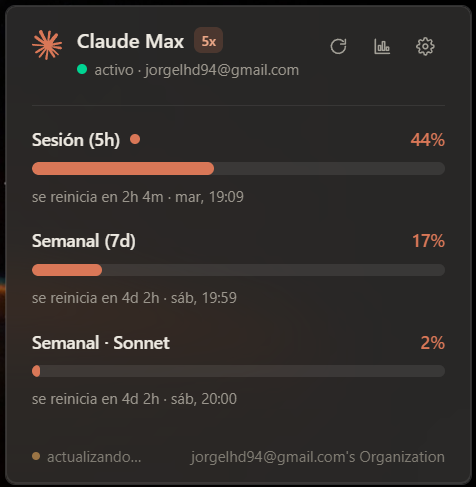
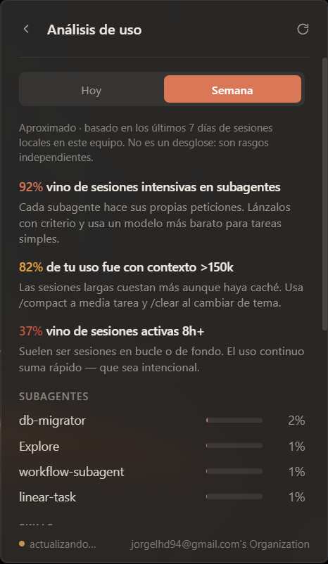

<div align="center">

# Claude Usage Widget

**A Windows 11 system-tray widget that shows your Claude Code usage at a glance.**

No more running `/usage` — your session, weekly and per-model limits live right next to the clock,
with reset countdowns, threshold notifications, and an animated tray icon while Claude is working.

[](LICENSE)


</div>

> **Unofficial community project.** Not affiliated with, endorsed by, or sponsored by Anthropic.
> See the [Disclaimer](#disclaimer) below.

---

## Screenshots

> _Drop your images in `docs/` and they'll render here._

| Usage | Settings | Analysis |
| :---: | :---: | :---: |
|  |  |  |

---

## Features

- **Live usage at a glance** — Session (5h), Weekly (7d) and per-model (Sonnet/Opus) limits, each with a
  progress bar, percentage and a "resets in…" countdown — the same numbers as Claude Code's `/usage`.
- **Tray-only, on-demand** — the icon appears **only while Claude Code is running** and disappears when you
  close it. No taskbar clutter.
- **Color-coded icon** — the Claude mark gets a status badge that turns amber/red as you approach your
  configurable thresholds, so you can read your usage without even opening the popup.
- **Working animation** — the icon animates while Claude is actively working (detected from local session
  activity), and goes idle when it stops.
- **Threshold notifications** — native Windows toasts when any window crosses your "warning" / "critical"
  levels, fired once per crossing (no spam).
- **Usage analysis** — a local, approximate breakdown of *what's driving your usage* (long context,
  cache misses, subagent-heavy sessions, high parallelism, long-running sessions) plus per-Skill,
  per-Subagent, per-Plugin and per-MCP-server attribution, for the last 24h and 7 days.
- **Modern UI** — borderless popup anchored above the tray, Apple-style acrylic "liquid glass" background,
  rounded corners, Claude's clay accent (`#D97757`), auto-sized to its content.
- **Starts with Claude Code** — an optional `SessionStart` hook launches the widget automatically when you
  open Claude Code (works from the terminal or the VS Code extension). Optional "start with Windows" too.

## How it works

The widget reads your existing Claude Code OAuth token from `~/.claude/.credentials.json` (the same file
Claude Code itself manages) and calls Anthropic's OAuth usage endpoints — the very same ones Claude Code
uses for its `/usage` panel:

- `GET https://api.anthropic.com/api/oauth/usage` — limits & reset times
- `GET https://api.anthropic.com/api/oauth/profile` — plan & account info

Because the widget only lives while Claude Code is open, your token is kept fresh by Claude Code in the
background — no separate login or OAuth refresh is implemented here.

- **Presence** — the backend polls the process list (`sysinfo`) to show/hide the tray icon based on whether
  Claude Code is running.
- **"Working" state** — a filesystem watcher (`notify`) on `~/.claude/projects/**/*.jsonl` detects active
  session writes to drive the icon animation.
- **Analysis** — usage attribution is computed locally by parsing your own session transcript `.jsonl`
  files. It never leaves your machine and is **approximate** (a best-effort reconstruction of the cost
  model, not official accounting).

## Privacy & security

- **100% local + first-party.** The only network calls are to Anthropic's official API, authenticated with
  **your own** token. There are no third-party servers, no analytics, and no telemetry.
- Your credentials are read from disk only to make those requests; they are never stored, logged, or
  transmitted anywhere else.
- The source is here for you to verify — see [`src-tauri/src/`](src-tauri/src/).

## Requirements

- **Windows 11** (also expected to work on Windows 10 22H2+).
- **WebView2** runtime — preinstalled on Windows 11.
- **Claude Code** installed and logged in (the widget reads its local credentials).

## Install

1. Download the latest `Claude Usage Widget_x.y.z_x64-setup.exe` from the
   [Releases](https://github.com/jorgelhd94/claude-usage-widget/releases) page.
2. Run the installer (it's an NSIS installer; Windows SmartScreen may warn about an unsigned app —
   choose *More info → Run anyway*).
3. Launch **Claude Usage Widget** once. Open the popup and, in **Settings**, enable
   **"Show when Claude Code opens"** to install the `SessionStart` hook, so it appears automatically
   from then on.

## Usage

- **Left-click the tray icon** to open the popup; click it again (or click away) to close it.
- **Settings** (⚙️):
  - **Show when Claude Code opens** — installs/removes a `SessionStart` hook in `~/.claude/settings.json`.
  - **Start with Windows** — registers an autostart entry (off by default; the hook usually covers it).
  - **Notifications** — toggle threshold toasts.
  - **Animate icon while working** — toggle the working animation.
  - **Refresh interval** — 1 / 2.5 / 5 / 15 min.
  - **Notify me at** — set the *warning* (amber) and *critical* (red) percentages.
- **Analysis** (📊) — toggle between *Today* and *This week* to see what's driving your usage.

## Build from source

**Prerequisites**

- [Rust](https://www.rust-lang.org/tools/install) (stable) + the MSVC toolchain (Visual Studio C++ Build Tools)
- [Node.js](https://nodejs.org/) 18+
- WebView2 (preinstalled on Windows 11)

**Develop**

```bash
npm install
npm run tauri dev
```

**Build the installer**

```bash
npm run tauri build
```

The NSIS installer is written to:

```
src-tauri/target/release/bundle/nsis/Claude Usage Widget_<version>_x64-setup.exe
```

## Tech stack

- **[Tauri v2](https://tauri.app/)** — Rust backend + web frontend, ~small installer, low memory footprint.
- **Backend (Rust)** — `reqwest`, `tokio`, `sysinfo`, `notify`, `chrono`, `resvg` (runtime SVG tinting of the
  tray icon), and the Tauri plugins `positioner`, `autostart`, `notification`, `store`, `single-instance`.
- **Frontend** — React 19 + TypeScript + Vite + Tailwind CSS v4.

```
src/                      React popup UI (App, components, hooks)
src-tauri/src/
  ├─ credentials.rs       read ~/.claude/.credentials.json
  ├─ usage.rs             fetch + parse usage & profile
  ├─ analytics.rs         local, approximate usage attribution
  ├─ watcher.rs           process detection + "working" activity watcher
  ├─ icons.rs             runtime tray-icon rendering (claw + status badge)
  ├─ settings.rs          persisted settings
  ├─ notifications.rs     threshold → toast logic
  ├─ commands.rs          commands exposed to the frontend
  └─ lib.rs               app setup, tray, window positioning, background tasks
```

## Disclaimer

This is an **unofficial, community-made** tool. It is **not affiliated with, endorsed by, or sponsored by
Anthropic**. It relies on undocumented OAuth endpoints that Claude Code uses internally; these may change or
break at any time. Usage figures (especially in the **Analysis** tab) are **approximate** and provided for
convenience only — always treat Claude Code's own `/usage` as the source of truth.

"Claude" and the Claude logo are trademarks of Anthropic. The logo is used here only to identify the
service this widget reports on.

Use at your own risk; see the [warranty disclaimer in the license](LICENSE).

## License

[MIT](LICENSE) © jorgelhd94
